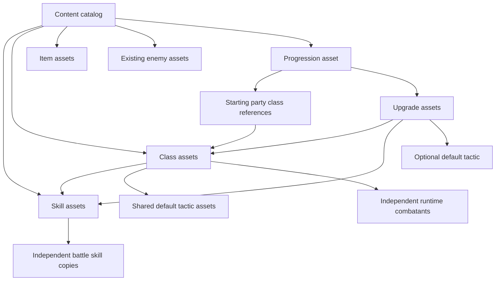

# Composable game content

Game definitions are authored as Godot Resources under `data/`. Resource scripts under `resources/` describe their fields; runtime systems under `systems/` consume them. Open `data/content.tres` in the Inspector to explore the registered content.



## Assets and responsibilities

| Location | Contents |
| --- | --- |
| `data/content.tres` | Explicit, ordered catalog of skills, classes, items, enemies and progression. References make assets reachable in exported builds. |
| `data/skills/*.tres` | All 25 active/passive skills, including power, MP, element, reach and status parameters. |
| `data/classes/*.tres` | Warrior, Cleric, Mage and Rogue stats, formation, direct skill references and default tactics. |
| `data/tactics/*.tres` | Reusable ordered strategy rules shared by class definitions. |
| `data/items/weapons`, `armor`, `accessories` | Eight gear definitions using the existing item folders. A charm belongs in accessories. |
| `data/enemies/*.tres` | Existing enemy definitions, now referenced by the catalog rather than a filename list in progression code. |
| `data/upgrades/*.tres` | Class unlocks, skill unlocks and rank upgrades. Each references its class and/or skill and contains its price and bonuses. Active skill unlocks compose a default tactic subresource. |
| `data/progression.tres` | Starting party, slot prices, party/rank caps and the available upgrade references. |
| `systems/content/content.gd` | Access to authored definitions and a factory for independent skill copies. |

`CrawlCombatContent` retains the combat fixture factory and a helper for constructing runtime tactic rules. `CrawlProgressionCatalog` builds party members from registered classes, applies purchases and validates ID-based profiles. Neither contains a second set of class stats or skill definitions. `CrawlRoomFlow` obtains its ordered loot pool from the catalog.

The progression resource derives its `class_costs`, `skill_unlocks`, `rank_costs` and `power_per_rank` maps from upgrade resources. These maps are compatibility views for purchase and save code, not additional authored sources. The lodge reads names and rank descriptions from the same definitions.

## Adding or changing content

1. Create a resource with the appropriate script in its existing data folder, or duplicate a similar `.tres`. Give it a unique stable ID and display name.
2. Register the asset in the matching array in `data/content.tres`. Order matters for seeded loot pools; do not casually reorder existing items.
3. For a starting class skill, assign the skill resource to the class's `skills` array and add any default tactic to its ordered `tactics` array. Tactic actions retain skill IDs for compatibility with editable strategies and saves.
4. For a purchased skill, create a `CrawlUpgradeDefinition` of kind `skill`, reference the class and skill, set the price and optionally author its default tactic. Register it in `data/progression.tres.upgrades`. For ranks, create a separate kind `rank` resource and set power and status-chance bonuses per rank. Class unlocks use kind `class`.
5. Add a new class either to the starting party or to a class unlock. Save validation, party construction and the lodge read the registered definitions, so another class does not require a new class-ID branch.
6. Run the content validation and relevant gameplay checks below. For intentional balance changes, update the migration baseline only after reviewing the expected gameplay changes.

The catalog checks duplicate IDs/purchases, missing or unregistered references, invalid skill/item/class values, invalid tactics, inconsistent slot costs and unavailable class unlock paths before opening a profile. Enemy dice and spawn validation remains in `CrawlEnemyValidation`.

## Ownership and persistence

Loaded resources are shared, read-only authoring inputs by convention. `CrawlContent.skills()` duplicates skill definitions before rank bonuses or battle-specific changes are applied. Class construction copies skill IDs and duplicates each tactic. Purchased default tactics are duplicated separately. Duplicate party members therefore do not share editable strategies, HP, MP or learned-skill arrays.

Loot pools return a new array containing immutable item definitions; inventory records own equipment assignment and runtime bonuses. Derived economy maps and new profile arrays are independent values. Never mutate a catalog asset during gameplay. When making a whole editable catalog copy in a tool or test, use `duplicate_deep(Resource.DEEP_DUPLICATE_ALL)`; ordinary `duplicate(true)` can retain references to external `.tres` assets.

Saves still contain IDs and primitive values, not resource paths or engine objects. Existing IDs, balance values and content version 4 are preserved, so this refactor requires no save migration. Unlock/learned-skill list bounds now follow the catalog instead of fixed limits, allowing all existing skill purchases to fit in a profile.

This is a definition/composition refactor. Turn scheduling, targeting, damage formulas, status lifecycle and specialized passive mechanics remain in simulation code. Creating a new combination of existing skill parameters is data authoring; inventing a new mechanic still requires an engine implementation. Enemy role behavior and the floor preview's encounter selection are also still implemented in their existing systems.

## Verification

```powershell
godot --headless --path . --editor --import --quit
godot --headless --path . --script tests/test_content.gd
godot --headless --path . --script tests/test_combat.gd
godot --headless --path . --script tests/test_warrior_passives.gd
godot --headless --path . --script tests/test_floors.gd
godot --headless --path . --script tests/test_room_flow.gd
godot --headless --path . --script tests/test_progression.gd
godot --path . --rendering-method gl_compatibility --script tests/test_progression_ui.gd
godot --path . --rendering-method gl_compatibility --script tests/test_ui_flow.gd
```

`tests/fixtures/content_baseline.json` was captured from the code-authored content immediately before migration. The content suite compares every authored skill/item field, class stats and tactics, economy values, enemy catalog order and four complete seeded combat event hashes. It also checks rank application, all skill unlocks, runtime isolation and invalid resource compositions. The fixture is a regression oracle, not a runtime content source.
